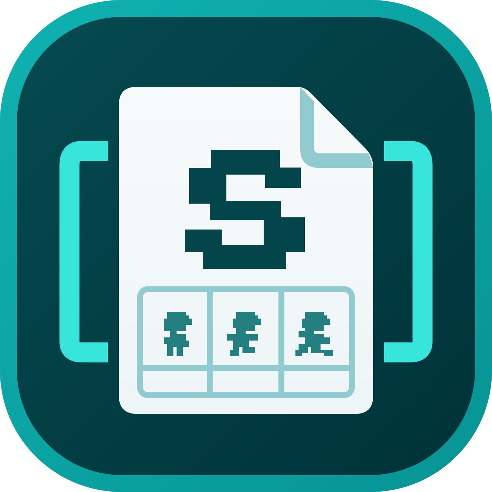

<div align="center">
  
  <h1>SpriteLab</h1>
  <p><strong>Edición de sprites, animación y preparación de recursos 2D.</strong></p>
  <p>Herramienta gratuita y de código abierto de <a href="https://github.com/Farga-Studios">Farga Studios</a>.</p>
  <p><a href="README.md">English</a> · Español · <a href="docs/USER-GUIDE.md">Manual</a> · <a href="https://github.com/Farga-Studios/SpriteLab/releases">Descargas</a></p>
</div>

## Características

| Área | Funcionalidades |
| --- | --- |
| Hojas de sprites | Importación PNG, asistente de cuadrícula, zoom e inspección |
| Animaciones | Direcciones, duraciones individuales, línea temporal y onion skin |
| Edición no destructiva | Desplazamientos, anclajes, guías, ajuste magnético, alineación, edición múltiple y deshacer/rehacer |
| Diagnósticos | Celdas vacías, duplicados, bordes y alineación; informes TXT/JSON |
| Procesamiento | Limpieza RGB transparente, umbral alfa y volteado |
| Exportación | Sprites, hojas corregidas, animaciones JSON, GIF, perfiles y lotes |
| Integridad | Verificación SHA-256 y recuperación no destructiva de exportaciones incompletas |
| Interfaz | Español e inglés, atajos y barra de ventana integrada |

## Instalación

Versión candidata: **0.6.8**. CI genera instalador y ZIP portátil para Windows x64. Todavía no hay una versión pública firmada de la aplicación.

[Descargas oficiales](https://github.com/Farga-Studios/SpriteLab/releases) · [Compilaciones de desarrollo](https://github.com/Farga-Studios/SpriteLab/actions/workflows/build.yml) · [Versión portátil](docs/PORTABLE.md).

Las compilaciones autocontenidas no requieren Python ni instalar el SDK .NET.

## Primeros pasos

Importa una hoja PNG, configura la cuadrícula, crea clips de animación, corrige y valida los fotogramas y exporta los recursos. Los archivos originales permanecen intactos.

## Compilar

Con el SDK .NET 10:

```powershell
dotnet restore SpriteLab.slnx
dotnet build SpriteLab.slnx -c Release --no-restore
dotnet test SpriteLab.slnx -c Release --no-build --no-restore
dotnet run --project src/SpriteLab.App -c Release --no-build --no-restore
```

Las dependencias se restauran desde NuGet.org sin credenciales privadas.

## Documentación y contribuciones

[Manual](docs/USER-GUIDE.md) · [Compilación](docs/BUILD.md) · [Hoja de ruta](docs/ROADMAP.md) · [Cambios](CHANGELOG.md) · [Incidencias](https://github.com/Farga-Studios/SpriteLab/issues).

Incluye versión, pasos y un ejemplo sin datos privados al informar de un fallo. Las actualizaciones firmadas todavía están en validación.

## Licencia

Código original bajo [MIT](LICENSE). Las dependencias conservan sus licencias. No se conceden derechos de marca.

---

<div align="center"><strong><a href="https://github.com/Farga-Studios">Farga Studios</a></strong><br/><em>Forging games. Empowering creators.</em></div>
