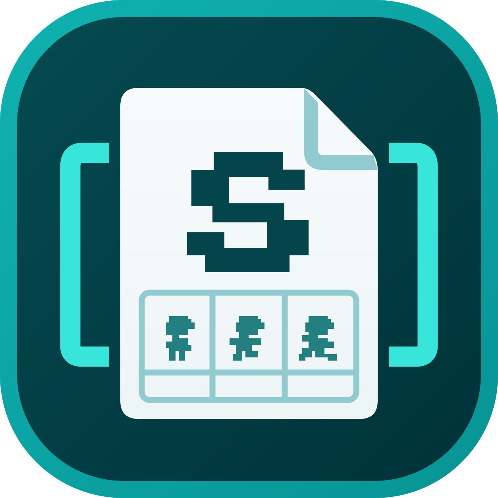

<div align="center">
  
  <h1>SpriteLab</h1>
  <p><strong>2D sprite sheets, animation and asset preparation.</strong></p>
  <p>Free, open-source desktop tools by <a href="https://github.com/Farga-Studios">Farga Studios</a>.</p>
  <p>
    <a href="https://github.com/Farga-Studios/SpriteLab/actions/workflows/build.yml"></a>
    <a href="LICENSE"></a>
    
  </p>
  <p>English · <a href="README.es.md">Español</a> · <a href="docs/USER-GUIDE.en.md">User guide</a> · <a href="https://github.com/Farga-Studios/SpriteLab/releases">Releases</a></p>
</div>

## Overview

SpriteLab helps game developers inspect, correct, animate and export 2D sprite sheets without modifying their original PNG files. It runs independently of any game engine, using .NET and Avalonia.

## Features

| Area | Capabilities |
| --- | --- |
| Sprite sheets | PNG import, grid suggestions, zoom and cell inspection |
| Animation | Directional clips, custom frame durations, timeline, playback and onion skin |
| Non-destructive editing | Offsets, anchors, guides, snapping, alignment, batch edits and undo/redo |
| Diagnostics | Empty cells, duplicates, clipping indicators and alignment checks; TXT/JSON reports |
| Image processing | Transparent RGB cleanup, alpha threshold and mirroring |
| Export | Individual sprites, corrected sheets, animation JSON and GIF; profiles and batch export |
| Integrity | SHA-256 export verification and non-destructive recovery of incomplete exports |
| Interface | English and Spanish, keyboard shortcuts and integrated window controls |

## Download and installation

**Development candidate: 0.6.8.** The Windows installer and portable ZIP are generated by CI. No signed public application release has been published yet.

- [Releases](https://github.com/Farga-Studios/SpriteLab/releases) — official distribution when available.
- [CI builds](https://github.com/Farga-Studios/SpriteLab/actions/workflows/build.yml) — development candidates.
- [Portable edition instructions](docs/PORTABLE.md).

Windows x64 is the currently targeted distribution platform. Self-contained builds do not require Python or a separately installed .NET SDK.

## Quick start

1. Import a PNG sprite sheet.
2. Set the cell dimensions or use the grid assistant.
3. Create an animation clip from a row and configure directions and timing.
4. Inspect and correct frames, then validate the sheet.
5. Export the desired sprites, animation metadata or GIF.

## Build from source

Install the .NET 10 SDK, then run:

```powershell
dotnet restore SpriteLab.slnx
dotnet build SpriteLab.slnx -c Release --no-restore
dotnet test SpriteLab.slnx -c Release --no-build --no-restore
dotnet run --project src/SpriteLab.App -c Release --no-build --no-restore
```

Dependencies restore from NuGet.org, including [FargaStudios.Suite.Updater](https://www.nuget.org/packages/FargaStudios.Suite.Updater/0.2.1). No private package credentials are needed.

## Documentation and contributions

[User guide](docs/USER-GUIDE.en.md) · [Build instructions](docs/BUILD.md) · [Roadmap](docs/ROADMAP.md) · [Changelog](CHANGELOG.md) · [Issues](https://github.com/Farga-Studios/SpriteLab/issues)

Bug reports and contributions are welcome. Include the application version, reproduction steps and a non-private example. Signed automatic updates are under validation; never share signing keys.

## License

Original project code is licensed under [MIT](LICENSE). Third-party dependencies retain their licenses. No trademark rights are granted.

---

<div align="center">
  <strong><a href="https://github.com/Farga-Studios">Farga Studios</a></strong><br/>
  <em>Forging games. Empowering creators.</em>
</div>
